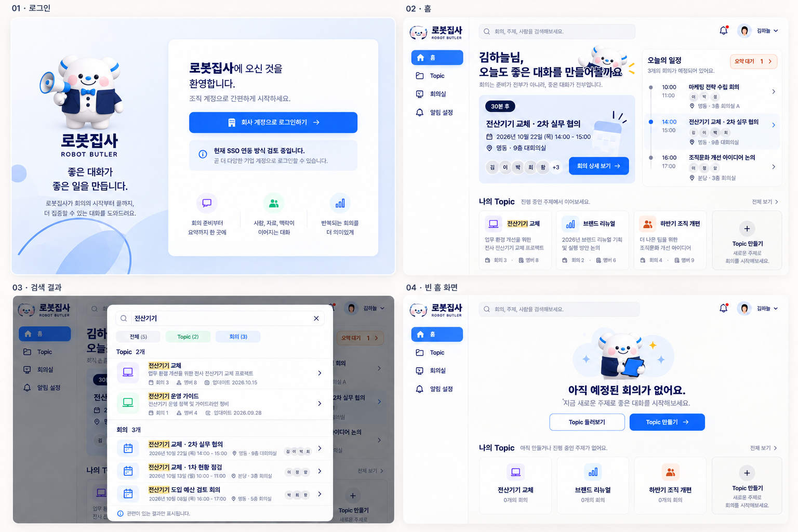

# 로봇집사 디자인 확정본 v1.0

기준일: 2026-10-20 (Asia/Seoul) · 상태: **시각 방향 승인 / 개발 인계 기준 작성 완료**

## 확정된 방향

| 항목 | 기준 |
| --- | --- |
| 서비스명 | 로봇집사 / ROBOT BUTLER |
| 전체 화면 스타일 | 1안 미팅집사의 밝은 화이트·블루·민트, 둥근 패널, 부드러운 그림자 |
| 홈 정보 구조 | 2안 모여: 왼쪽 임박한 회의, 오른쪽 오늘의 일정, 아래 Topic 카드 |
| 캐릭터 | 하얀 몸, 파란 귀 장식, 파란 코, 검은 눈, 볼터치 + 네이비 재킷·나비넥타이 |
| 주요 흐름 | 로그인 → 홈/검색 → Topic → 회의 생성·예약 → 자료 → 요약 → 명시적 완료 |
| 개발 범위 | 시안을 실제 UI로 재현. 외부 연동과 미정 정책은 별도 확정 |

사용자는 전체 20화면 흐름을 확인한 뒤 캐릭터·이름을 로봇집사로 변경했고, 이 방향을 최종 선택했다. 아래 세부 수치와 상태 규칙은 시안과 원래 명세를 개발 가능하게 정리한 기준이다. 모든 수치가 사용자에게 개별 승인되었거나 이미지에서 정확히 측정된 값이라는 뜻은 아니다.

## 기준 우선순위

1. 이후 사용자가 명시적으로 승인한 변경
2. 이 문서 모음의 명시적 동작·권한·디자인 규칙
3. 최신 로봇집사 브랜드 보드(이름·캐릭터), 화면별 보드(레이아웃)
4. 과거 콘셉트 이미지와 예시 문구

노션 명세와 이 문서가 충돌하면 자동으로 어느 한쪽을 덮어쓰지 말고 변경 내용을 확인한다. 이번 문서는 아래 출처의 **대화 중 열람한 명세 스냅샷**을 사용했다. 노션의 이후 변경을 자동 동기화하지 않는다.

출처: [요구사항 상세화](https://cloud-whistle-8a1.notion.site/3f0400c4083d80d5a1fff366920f5f0c)

## 승인 시안과 적용 범위

| 파일 | 화면 | 적용 |
| --- | --- | --- |
| [01-brand-and-entry.png](assets/01-brand-and-entry.png) | 01–04 로그인·홈·검색·빈 홈 | 최신 로봇집사 이름·캐릭터. 모든 화면의 브랜드 기준 |
| [02-topic-and-permissions.png](assets/02-topic-and-permissions.png) | 05–08 Topic·권한 | 구조 기준. 옛 이름·로고는 로봇집사로 교체 |
| [03-meeting-creation.png](assets/03-meeting-creation.png) | 09–12 생성·예약 | 구조 기준. 단계 번호는 문서의 4단계로 수정 |
| [04-meeting-lifecycle.png](assets/04-meeting-lifecycle.png) | 13–16 상세·자료·요약·취소 | 구조 기준. 완료와 취소 확인은 서로 다른 상태 |
| [05-notifications-and-admin.png](assets/05-notifications-and-admin.png) | 17–20 알림·관리자 | 구조 기준. 필수 알림은 잠금, 보조 기능과 미정 연동 구분 |
| [reference-home-v2-blue.png](assets/reference-home-v2-blue.png) | 모여 블루 콘셉트 | 홈 정보 구조 참고만. 모여 이름·외곽 마케팅 문구 사용 금지 |

## 이미지 해석 시 반드시 수정할 부분

- 생성 흐름은 **기본 정보 → 장소·시간 → 참가자 선택 → 자료·알람 설정** 4단계다. 완료 화면은 입력 단계가 아니다.
- 회의 생성·변경·취소 알림은 항상 켜짐이며 비활성 스위치 또는 잠금 아이콘으로 표시한다.
- Topic 생성자의 Owner와 개별 회의 생성자는 다른 개념이다. 참가자 선택에서 직급 또는 주최자라는 이유로 Owner를 부여하지 않는다.
- 홈 인사말과 캐릭터가 겹치지 않게 캐릭터 영역을 분리한다. 헤더·카드 정보를 가리지 않는다.
- 빈 홈의 “예정된 회의 없음”과 “참여 Topic 없음”은 별도 상태다. 실제 데이터가 없다면 예시 Topic을 노출하지 않는다.
- 회의가 끝났어도 자동 완료하지 않는다. “요약 작성 필요” 상태를 거쳐 생성자가 완료 처리한다.
- 16번 보드의 완료 화면 위 취소 확인창은 **별도 예정 회의 상태 예시**다. 완료 화면에서 취소창이 기본 노출되는 구조가 아니다.
- 관리자 5명, 첨부 최대 100MB, 제목 글자수, 보존 기간 등 이미지가 임의로 제시한 제한은 확정 요구가 아니다.
- 모든 예시 인원수·날짜·파일명·통계는 데이터 바인딩으로 일치시킨다. SSO 검토 안내 등 개발자용 주석은 출시 화면의 일반 사용자 문구로 복사하지 않는다.
- 서비스 내 알림함은 보조 제안이다. 사용자 승인 전 필수 MVP 기능으로 간주하지 않는다.

## 문서 구성

- [DESIGN-SYSTEM.md](DESIGN-SYSTEM.md): 토큰, 컴포넌트, 반응형, 캐릭터 사용
- [tokens.json](tokens.json): 프레임워크에 독립적인 디자인 값
- [SCREENS.md](SCREENS.md): 20개 화면의 진입·동작·권한·예외
- [BEHAVIOR.md](BEHAVIOR.md): 상태, 권한, 예약, 알림 규칙
- [OPEN-DECISIONS.md](OPEN-DECISIONS.md): 미정 사항과 구현 시 처리
- [QA.md](QA.md): 화면·기능·접근성 수용 기준
- [project-instructions.txt](project-instructions.txt): 기존 프로젝트 지침에 덧붙일 문구
- [CHANGELOG.md](CHANGELOG.md): 변경 이력
- [asset-manifest.json](asset-manifest.json): 이미지 역할과 SHA-256

## 인계와 후속 작업

프로젝트 지침에는 `project-instructions.txt`를 **기존 Git 규칙을 유지하면서 추가**한다. 실제 ChatGPT 프로젝트 설정은 이 파일 생성만으로 변경되지 않는다.

개발 세션에서는 저장소 최신 상태를 확인하고 `AGENTS.md`부터 읽는다. 권장 구현 순서는 토큰·공통 컴포넌트 → 홈·검색 → Topic → 생성·예약 → 상세·자료·요약 → 알림·운영이다. 먼저 화면 02 홈을 기준으로 공통 스타일을 맞춘 뒤 확장한다.

이미지는 최종 앱 에셋 묶음이 아니다. 로고·마스코트의 투명 배경 개별 파일, 승인된 포즈, 회의실 실제 사진·안내 경로는 구현 전에 별도 준비한다. 기존 보드 이미지를 배경으로 깔아 클릭 영역만 올리는 방식은 금지한다.
